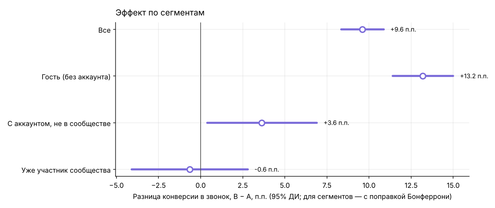
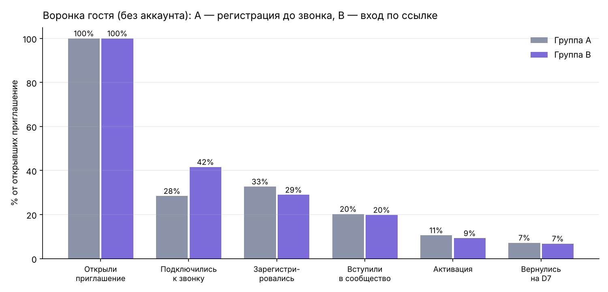
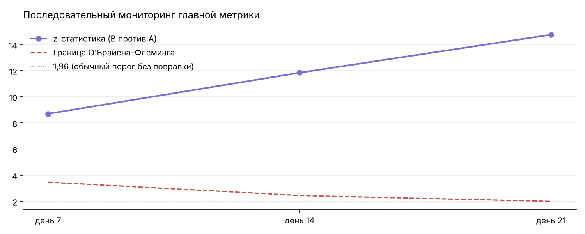
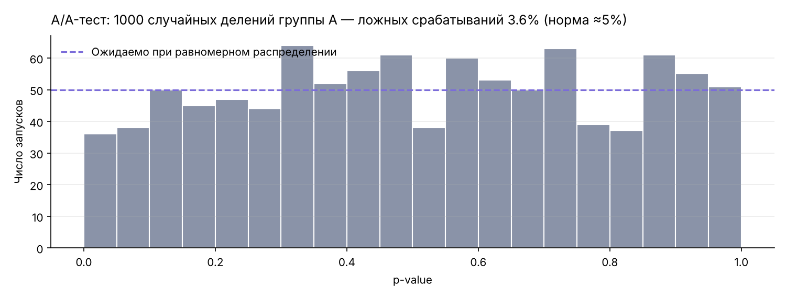
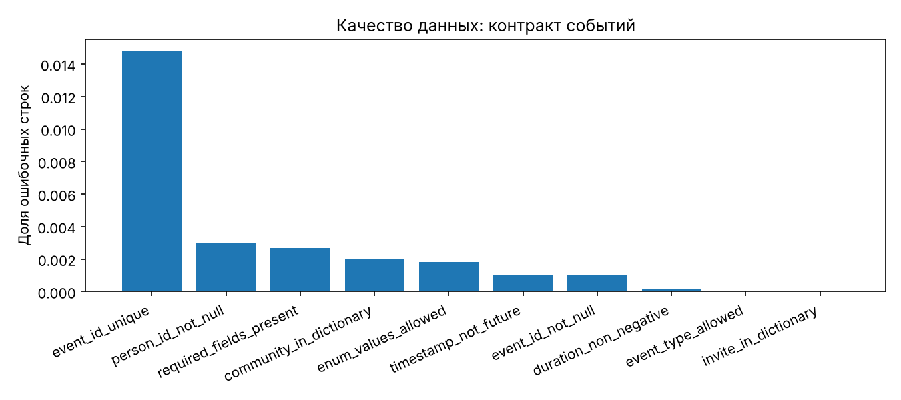
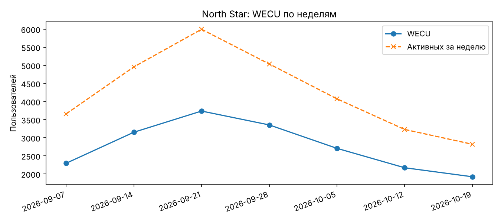
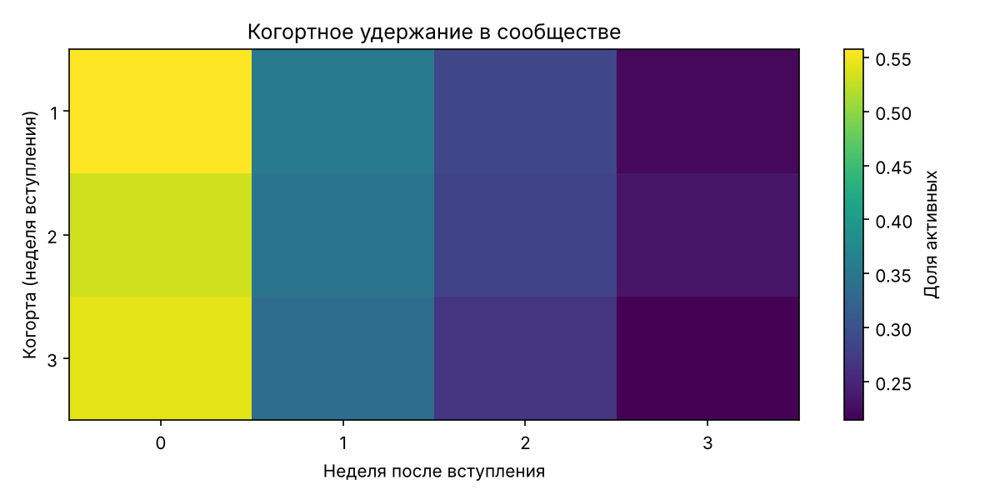

# Отчёт: A/B-тест «вход в звонок по ссылке без регистрации»

Результаты на синтетических данных. Числа получены запуском кода из этой папки (seed = 42) и воспроизводятся.

## Главное — для слайда

- **Conversion to Call Join: A 42,2% → B 51,8%, +9,6 п.п.** (95% ДИ +8,3 п.п. … +10,9 п.п.), относительный прирост **22,8%**, p < 0,001.
- Эффект почти целиком у **гостей без аккаунта**: заложено +12 п.п., тест нашёл **+13,2 п.п.**
- **Защитные метрики в границах**, но в B немного хуже: активация −3,8 п.п., удержание D7 −3,3 п.п., ранний выход +2,6 п.п. — всё в пределах заданных границ
- **Метод проверен**: группы поделились ровно (SRM p = 0,09), A/A-тест даёт 3,6% ложных срабатываний при норме ≈5%.
- **Решение: Внедряем: конверсия в B значимо выше, защитные метрики в границах. Небольшое снижение активации и удержания в B стоит наблюдать после запуска.**

## Зачем синтетика

Реальных пользователей у платформы пока нет, поэтому метрики и дизайн теста проверены на **синтетических данных**: код «придумывает» людей, проигрывает их путь по воронке, а затем те же расчёты, что пойдут на реальных данных, считают метрики и результат теста.

Эффект в группе B **заложен заранее**. Так проверяется сам метод: находит ли тест эффект, который точно есть, и не находит ли его там, где его нет (A/A-тест).

## Как устроены данные

- **24 000 человек** открывают ссылки-приглашения в 40 сообществ за 21 день набора, дальше 21 день наблюдения. Плюс 3 000 «старожилов» — фон для WECU.
- **Группа** назначается по хешу устройства, 50/50: один человек всегда в одной группе, сколько бы раз ни открывал ссылку.
- **Сегмент** фиксируется при открытии ссылки: гость без аккаунта (65%), с аккаунтом, но не в сообществе, уже участник сообщества.
- **События и поля — по схеме платформы:** invite_link_opened, call_joined, registration_completed, community_joined, community_interaction, error_occurred, community_left.
- **«Грязь»** подмешана нарочно: дубли, пропуски идентификаторов, недопустимые значения, неизвестные сообщества, время то в МСК, то в UTC.

| Сегмент | Конверсия в звонок, A | Конверсия в звонок, B | Заложенный эффект |
|---|---|---|---|
| Гость (без аккаунта) | 30% | 42% | +12,0 п.п. |
| С аккаунтом, не в сообществе | 66% | 67% | +1,0 п.п. |
| Уже участник сообщества | 80% | 80% | нет |

Остальные вероятности (регистрация, вступление, активация, удержание, ранний выход, ошибки) — в `Config` в начале `ab_experiment/generate.py`. Это допущения модели, а не измерения продукта.

**Очистка Bronze → Silver → Gold:** из 323 912 сырых событий в серебряный слой прошло 316 892; **7 020 (2,2%) ушли в карантин** с причиной:

| Причина | Строк |
|---|---|
| Дубль event_id | 4 787 |
| Нет ни user_id, ни anonymous_id | 963 |
| Сообщества нет в справочнике | 664 |
| Недопустимый action_type | 542 |
| Недопустимый join_status | 35 |
| Отрицательная длительность | 29 |

## Дизайн и планирование

- Рандомизация по пользователю 50/50 по хешу устройства, группа фиксируется при первом открытии ссылки.
- A — регистрация до звонка, B — вход в звонок по ссылке, регистрация после.
- Выборка: p₁ = 42,8%, MDE = 3%, α = 0,05, мощность 80% → **4 304 на группу** (8 608 всего), **14 дней** при ~1 137 открытиях в день.
- Чувствительность: MDE 1 п.п. → 38 542 на группу, 2 п.п. → 9 661, 5 п.п. → 1 556.
- Фактически в тесте: A 12 070, B 11 808 человек.

## Защитные метрики

| Метрика | A | B | Разница | Граница | Итог |
|---|---|---|---|---|---|
| Activation Rate | 52,2% | 48,4% | −3,8 п.п. | −5 п.п. | в границах |
| Доля раннего выхода | 7,0% | 9,6% | +2,6 п.п. | +5 п.п. | в границах |
| Community Retention D7 | 36,4% | 33,1% | −3,3 п.п. | −5 п.п. | в границах |
| Доля технических ошибок | 3,7% | 4,7% | +1,0 п.п. | +30% относительно | в границах |

## Сегменты (поправка Бонферрони, α = 0,05 / 3)

| Сегмент | Заложено | Оценка | ДИ | Значимо |
|---|---|---|---|---|
| Гость (без аккаунта) | +12,0 п.п. | +13,2 п.п. | +11,4 … +15,0 п.п. | да |
| С аккаунтом, не в сообществе | +1,0 п.п. | +3,6 п.п. | +0,4 … +6,9 п.п. | да |
| Уже участник сообщества | +0,0 п.п. | −0,6 п.п. | −4,1 … +2,8 п.п. | нет |

## Воронка по шагам

| Шаг | A | B |
|---|---|---|
| Открыли → звонок | 42,2% | 51,8% |
| Гость: звонок → регистрация | 100,0% | 69,0% |
| Гость: открыл → регистрация | 32,7% | 28,9% |
| Регистрация → вступление | 62,0% | 68,5% |
| Вступление → активация | 52,3% | 48,0% |

График — воронка гостя без аккаунта (основной сегмент эффекта):

## Последовательный мониторинг (О'Брайен–Флеминг)

| Проверка | Участников | A | B | z | Граница | Пересекли |
|---|---|---|---|---|---|---|
| день 7 | 6 782 | 43,5% | 54,0% | 8,71 | 3,47 | да |
| день 14 | 14 708 | 42,6% | 52,4% | 11,85 | 2,45 | да |
| день 21 | 22 768 | 42,2% | 52,0% | 14,76 | 2,00 | да |

Эффект виден уже на первой проверке, но по плану досрочно останавливаемся только при вреде — решение после 14 дней.

## A/A-тест

Группу A 1000 раз случайно делили пополам: значимых различий 3,6% (норма ≈5%), p-value распределены равномерно (KS p = 0,062).

## Данные и метрики продукта

Модуль `community_events_synthetic.py` — отдельный прогон (другой объём и случайные числа), поэтому цифры воронки немного отличаются от эксперимента выше.

- **Качество данных:** из 308 503 сырых событий в карантин ушло 7 296 (2,4%).

| Проверка | Ошибок | Доля |
|---|---|---|
| event_id_unique | 4 556 | 1,48% |
| person_id_not_null | 924 | 0,30% |
| required_fields_present | 826 | 0,27% |
| community_in_dictionary | 615 | 0,20% |
| enum_values_allowed | 567 | 0,18% |
| timestamp_not_future | 309 | 0,10% |
| event_id_not_null | 306 | 0,10% |
| duration_non_negative | 62 | 0,02% |

- **WECU по неделям:** 2 295, 3 152, 3 737, 3 354, 2 707, 2 171, 1 922 (пик 3 737).
- **Когортное удержание** (доля активных по неделям после вступления):

| Когорта | Неделя 0 | Неделя 1 | Неделя 2 | Неделя 3 |
|---|---|---|---|---|
| 1 | 56% | 36% | 29% | 22% |
| 2 | 53% | 35% | 28% | 24% |
| 3 | 54% | 34% | 27% | 21% |

- **CAC по каналам:**

| Канал | Новых пользователей | Расходы, ₽ | CAC, ₽ |
|---|---|---|---|
| ads | 851 | 240 000 | 282 |
| organic | 2 051 | 0 | 0 |
| referral | 1 214 | 60 000 | 49 |

## Выводы

- Тест нашёл заложенный эффект: у гостей заложено +12 п.п., оценка +13,2 п.п.; доверительный интервал накрывает истинное значение во всех сегментах.
- В B хуже активация, удержание D7 и ранний выход: часть людей заходит в звонок «на пробу». Отклонения в пределах заданных границ, но после внедрения за ними нужно следить.
- Регистрации гостей в B ниже, чем в A (28,9% против 32,7%). В модели это следствие допущения, сколько гостей регистрируются после звонка. На реальных данных это главный вопрос вторичной гипотезы: стоит отдельно продумать момент и форму предложения зарегистрироваться.

## Ограничения

- Все вероятности — допущения модели; выводы проверяют метод, а не продукт.
- Пользователи A и B в модели не влияют друг на друга. В жизни они могут оказаться в одном звонке; если влияние подтвердится — кластерная рандомизация по сообществу.
- Границы защитных метрик (5 п.п., 30%) взяты для примера; в реальном тесте их фиксируют до запуска по историческим данным.

## Файлы в этой папке

| Файл | Что это |
|---|---|
| `ab_summary.csv` | Главная и защитные метрики A/B одной таблицей |
| `ab_segments.csv`, `ab_monitoring.csv`, `ab_funnel.csv` | Сегменты, мониторинг, воронка |
| `ab_*.png` | Графики эксперимента |
| `data_*.csv`, `data_*.png` | Качество данных, WECU, когорты, CAC |
